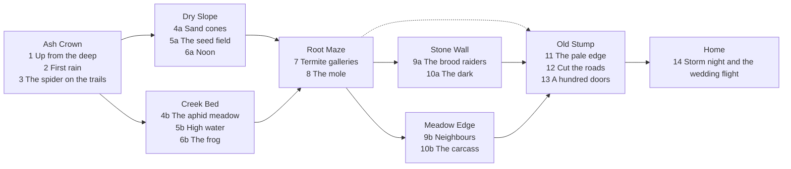
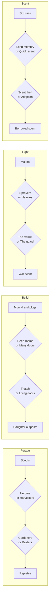

# Cinderhill: the full game

Written 2026-11-27 after the owner played the first slice of the rebuild and said the spec was too basic. The owner's ask, in his words: "an Empires of the Undergrowth alike game. Missions, worthwhile base building, strategy, variety, progression and tech tree, meaningful decision branch." Graphics do not have to match the reference. The model is freeciv beside Civilization: the same depth of genre, our own expression.

This file sets the size and shape of the whole game. [02-spec.md](02-spec.md) stays the authority for the numbers of the first three missions (pace budget, starting values, the first five minutes). Where the two differ, this file wins.

## 0. What this file replaces

| 02 said | Now |
| --- | --- |
| Done is six Spring chapters on one hill | Done is a campaign of 19 missions on a branching map, a home nest worth building, a tech tree with exclusive picks, ten castes (seven or eight in any one playthrough), twelve kinds of enemy and three rival colonies. A first-time player finishes mission 3 without help and starts mission 4. Two playthroughs can differ in the order of six missions, in which two of four they play at the second fork, and in all eight tree picks |
| "Progress is the colony itself and the bloom". No currency between chapters | The colony still carries. Added: a tech tree, the **Lineage**. A node opens by a **deed** (something the colony did) and is paid for in real stores from the home nest. There is no separate currency |
| A room's worth comes from depth, size and dryness only | Rooms have a function, a capacity and a **supply time** (walking time to what the room needs, read from the flow fields). Layout decides output |
| Wordless play | No narrator and no story text. Mission goals, room names and Lineage picks have short labels, because a strategy choice the player cannot read is not a choice |
| Six chapters with one new verb each | Missions of six types on seven regions, each with a main goal, two side goals and one dilemma |

Everything else in 02's "Not taken" table still holds: no narrator, no lab or scientists, no hex tiles or neighbour upgrades, no numbered scent groups, no shared class name for big animals, none of the excluded biology in [07](07-biology-ideas.md), nothing of the reference game's names, levels, look, UI or music. The owner's earlier taste calls (11 and 12) hold where this file does not change them.

## 1. The six things, one row each

| Asked for | The decision the player makes | What the sim must hold | In sim 11 today |
| --- | --- | --- | --- |
| Missions | Which goal to chase first; whether a side goal is worth the risk; when to stop growing and commit | A mission record (map, start, goals, timed and triggered events, rewards) read as config; goal state and win or loss as sim state and events | Days with a food quota and a dusk event. No goals, no scripts |
| Worthwhile base building | Where each room goes, how deep, how wide the tunnels and how many doors: short supply lines against flood, raid and jam risk | Room kinds painted on dug cells; capacity per cell; supply time per room from flow fields; stores that live in rooms; a population cap from rest halls | Free digging, a nursery rectangle, doors with throughput and jams. One global store |
| Strategy | Where to spend ants: forage, dig, guard, scout, raid. Which food site to hold. Which trail to hide or use as bait | Rival colonies that play by the player's own orders; shared scent; sight (unscouted ground is hidden); contested sites; castes with counters | Trails, crews, alarm, recall, one spider, majors. One team of ants |
| Variety | Which castes to raise and what to feed them; how to answer each enemy | Nine castes with different speed, load, strength and job; twelve enemy kinds, each with one readable rule and one counter; four food chains; weather and time of day | Worker and major. Sugar and protein piles |
| Progression and tech tree | Which Lineage bough to grow first; which of two exclusive picks at each fork | Tech as a bit set in the mission config that changes rules deterministically; unlock checks inside the sim so a replay is exact | None |
| Meaningful decision branch | Which region to settle first (the other changes while you are away); a dilemma in each mission whose result comes back later | Campaign state outside the sim (a new storage key); mission config built from it (flags such as "neighbours spared") | None |

## 2. Shape of the campaign

The colony survived the fire under the crown of the hill. Each mission sends a young queen and an escort to found a **daughter nest** in a new place. Win, and that nest joins the colony: it sends a steady trickle of its region's food home and opens the regions beyond it. Lose, and the escort is lost; the colony carries on smaller (owner choice 12-E) and may try again. The campaign map is therefore a picture of the colony's own network spreading over the hill, and the hill turning green behind it.

On the far side of the hill a second network is spreading the same way: the **pale colony**, many nests under one scent. The last region is where the two meet.

**Forks.** After mission 3 the player settles Dry Slope or Creek Bed first. The other stays open, but it changes while the colony is away: the pale colony's scouts reach it, so its missions start with a rival already holding the best site. After the Root Maze the player goes to Stone Wall or Meadow Edge; the one not chosen falls to the pale colony and becomes one of its nests in the last region. A playthrough is 17 missions out of 19.

**Mission types.** Every mission has one main goal, two side goals (each is a deed that opens or cheapens a Lineage node) and one dilemma.

| Type | Main goal | Missions |
| --- | --- | --- |
| Found and grow | Reach a colony size or a store by dusk | 1, 4b, 5a |
| Hold | Keep the queen alive through an event | 2, 6a, 9a, 11 |
| Hunt or drive off | Beat or outlast one large animal | 3, 6b, 8 |
| Route | Open and run a supply line through hazards | 4a, 12 |
| Move | Carry the queen and brood to a new nest before the old one is lost | 5b, 10a |
| Contest | Take or hold a site against another colony | 7, 9b, 10b, 13, 14 |

**The second and third mission of a region start in the daughter nest the player built there in the first**, with its rooms, tunnels and stores. A founding happens once per region, not once per mission.

**Dilemmas** are choices inside a mission that the campaign remembers. Each is made by play, not by a dialog. The rule for every dilemma: each option pays something now and costs something later, in the same measure, and the cost is shown before the choice. Examples: in *Termite galleries* the player can break into the termite nest for protein (protein now and a permanent shortcut through their galleries; termite soldiers come up that shortcut in mission 8) or wall it off (no protein; the wall holds in mission 8 but the Root Maze road stays long). In *Neighbours* a beaten rival can be finished (its brood is protein now; its survivors join the pale colony) or fed from the stores meant for the next escort (a smaller start next mission; the neighbour holds one road in mission 11). In *The carcass* three colonies want one dead vole; holding all of it pays the most protein and starves the smallest colony, who then joins the pale colony; the card shows how much the smallest needs before the player takes its share.

## 3. The home nest

Between missions the player is at the **home nest**, the same sim as a mission. It persists. Home has no clock of its own: **nothing accrues while the player waits.** Each mission played pays home once (the harvest of every daughter nest, plus what the escort brought back), and that harvest is all there is to spend on three things that compete: raising the next escort, digging and building, and Lineage nodes.

- **The expedition.** Each mission's escort is drawn from home: a number of slots set by the home rest halls, filled by caste from what the home nurseries have raised and the home stores can provision. A better home sends a stronger start.
- **It is attacked.** Missions 9a and 14 are fought in the home nest as the player built it, with its real doors, tunnels and stores.
- **Repair.** Any room can be repainted and any tunnel refilled, at a cost in loads from the same harvest. No early mistake is permanent.
- **A floor.** A lost escort still brings back its scout map and whatever brood its carriers physically got out. Home never sends fewer than a floor escort.

## 4. Base building

Free digging stays. A **room** is a dug space painted with a kind. Its output is capacity times a rate, and the rate falls as its supply time rises.

| Room | Does | Wants | Opened by |
| --- | --- | --- | --- |
| Queen's chamber | Lays eggs. Enlarging it raises the colony's **tier** (1 to 4), which opens room kinds and castes inside a mission | Deep and dry; short path to a nursery | Start |
| Nursery | Raises brood. A **diet** set on the room (lean, rich, or a special food) decides the caste | Short path to the larder; warmth near the surface by day, depth by night | Start |
| Granary | Keeps seeds and sugar | Dry; near a door | Start |
| Larder | Keeps protein; it spoils slowly if warm | Deep and cool | Mission 2 |
| Rest hall | Raises the population cap; resting ants heal | Anywhere; near doors it doubles as a muster point | Mission 3 |
| Midden | Takes husks and the dead. Near brood it causes sickness; near the surface it sprouts (bloom) | Far from nurseries | Mission 1 |
| Guard post | Holds a set number of fighters at a door or junction | A tunnel one or two cells wide | Lineage |
| Root stable | Root aphids give sugar underground with no trail to defend | Tree roots in the soil | Lineage (Herders) |
| Fungus garden | Turns leaves into food on a delay; its waste must reach the midden | Deep, damp, never flooded | Lineage (Gardeners) |
| Honey hall | Repletes hang here as living stores that can walk to a new nest | Deep | Lineage |
| Thatch dome | Warms the top nursery so brood grows faster; burns in a dry storm | The surface mound | Lineage (Thatch) |

**Layout has no single right answer because rooms pull against each other:**

- Supply time is path time through the tunnels as dug, read from the flow fields. It is never a count of neighbouring rooms.
- Water pools low: the deepest rooms flood last but drain last, and a flooded approach strands the stores behind it.
- Larders and fungus gardens give off heat and stale air (an integer diffusion layer on the nest grid). Brood near them sickens unless a second shaft to the surface draws a draught, and every shaft is a way in for rain and raiders.
- A granary by the door has the shortest supply time and is the first thing a raid reaches.
- Raising the queen's chamber a tier stops laying for a minute and spends stores, so tiering late is sometimes right. The ledger shows when one more worker will repay her food before dusk.
- A rest hall is a muster point: war crews (section 6) form at the rest hall nearest their trail, so where it sits decides how fast the colony answers.

Tunnels have a width the player chooses. Narrow tunnels are cheap and easy to hold; wide ones carry traffic. Doors have throughput (already in the sim), so a second door is a real trade between speed and exposure. Water, cave-ins and the structures of 02 section 6.5 stay.

## 5. The Lineage (tech tree)

Four boughs of four levels. A node opens by a **deed**: a region bloomed, an enemy kind beaten, a side goal met, a dilemma's outcome. It is then bought with stores from the home harvest (seed, sugar, protein, or raised brood of a set caste), so the tree competes with the escort and the home for the same food. At levels 2 and 3 each bough **forks**: the player takes one side and the other is closed for this campaign. That is eight exclusive picks, all reachable by the middle of the campaign. Level 4 nodes are capstones that read both earlier picks. The wedding flight at the end carries one fork pick into a new campaign on a harder hill.

No pick removes a threat or a system. Each side is strong against about half the roster and half the mission types. Numbers here are starting values for the equal-cost test of 02 section 6.4, which counts the foraging given up.

| Fork | One side | Other side |
| --- | --- | --- |
| Forage 2 | **Herders**: aphid herds give steady sugar that walks with the colony in a Move mission and pays a cold-night bill; a herd on the surface must be guarded, a root herd gives less | **Harvesters**: seeds keep and pay a dry-spell bill; they must be cracked, which takes majors off the line; a full granary draws pests and raids |
| Forage 3 | **Gardeners**: leaves become food on a delay in a safe room; the leaf trail is long and exposed, and the waste must reach a midden | **Raiders**: brood and stores taken from rivals and termites come home as food or as workers; a quick raid on a supply line pays even when losing; it pays nothing against animals |
| Build 2 | **Deep rooms**: worth more with depth; water reaches them half as fast; every trip is longer and brood grows slower in the cold unless vented | **Many doors**: doors are cheap and each adds throughput and a flanking exit; each also draws one more rival scout, and raids go for the least guarded door |
| Build 3 | **Thatch**: brood grows a third faster and the dome sheds rain; it can burn in any dry mission and in the last one | **Living doors**: a door caste (two protein each) closes a tunnel one cell wide and takes twenty bites before she falls; a sealed door also stops the colony's own traffic, so a small siege can starve a large nest |
| Fight 2 | **Sprayers**: acid at range; strong in the open, over a plug and against anything holding a narrow tunnel; weak when reached | **Heavies**: slow giants that pin large animals and hold a tunnel; too slow to guard a long trail and costly to feed |
| Fight 3 | **The swarm**: two larvae to a nursery cell and workers at half the protein; numbers in the open | **The guard**: fighters who survive a fight grow stronger and carry over; each takes two escort slots and eats double; a dead veteran is gone |
| Scent 2 | **Long memory**: trails last all day and become highways (faster, bigger loads) with use; rivals and the spider read them easily | **Quick scent**: trails cost nothing to redraw, fade in a minute, cannot be followed by scouts and are not wiped by slime; no highway bonus |
| Scent 3 | **Scent theft**: scouts read where a rival's crews are going and what its nurseries are raising | **Adoption**: workers of a colony defect to the player during a fight that is going the player's way, and stay |

Nodes that do not fork: Scouts (fast, see far, lift the fog, mark food and danger), Mound and plugs, Majors, Six trails (up from four, with crew presets), Repletes (living stores that walk), Daughter outposts (a second small nest inside a mission), War scent (three war trails released on one tick), Borrowed scent (walk a rival's trail unnoticed for a while).

Inside a mission none of this is free: a pick opens a room or a caste, and the colony must still reach the tier, dig the room and feed the brood. A scout's report (what the rival is raising, when a convoy leaves) arrives early enough to change a nursery's diet and hatch the answer.

## 6. Castes and enemies

**Castes.** Worker (the youngest nurse; that is an age, not a caste), scout, major, sprayer or heavy, replete, door caste, gardener (tiny, cannot fight), adopted workers, and the winged ones of the last mission. Ten exist; one playthrough raises seven or eight.

**Enemies**, each with one rule the player can see and one clean answer:

| Enemy | Rule | Answer |
| --- | --- | --- |
| Bird | Strikes the densest group in the open after a shadow | Cover, thin trails, recall |
| Spider in ant scent | Walks the busiest trail | Cut the trail, majors, a decoy |
| Antlion | A pit that takes whatever walks the slope | Route around, fill it, a span |
| Wasp | Lifts single foragers from the edges of a trail | Roofs, short trails, sprayers |
| Frog | Eats in a cone in front of it, sleeps at noon | Come from behind, pass at noon, lure it with a carcass onto a rival |
| Mole | Tunnels through the nest and collapses loose rooms | Roots and clay, plugs, heavies at the breach |
| Termites | Soldiers that hold any tunnel one cell wide | Break in from two sides, or wall them off |
| Guest beetle | Lives in the nest unseen and eats brood | Guard posts at the nursery, a clean midden |
| Brood raiders | A rival that takes pupae, not food | Plugs, living doors, moving brood deep |
| Slug | Lays slime that wipes scent | Redraw, or use it to erase a trail a rival is reading |
| Neighbour colonies (three temperaments: harvesters that turtle, a small fast colony that raids, a large slow one that claims food sites) | The player's own orders and rules | Everything above |
| The pale colony | Many nests, one scent, no borders between them | Cut its roads; take nests one at a time |

Combat keeps the contact rule of 02 section 6.4: numbers win in the open, quality and doors win in a tunnel. Large animals go for the largest colony on the map first, which slows a runaway leader.

### Orders for war

Trails, crews, Alarm and Recall are not enough to fight a colony. Five additions, all on the route card, and the rival uses the same five:

| Order | What it does |
| --- | --- |
| **Raid** | A toggle on a trail. Its crew fights at the trail's end and carries the dead, brood and stores home |
| **Who goes** | Caste chips on the crew (workers, majors, sprayers or heavies). The crew musters at the nearest rest hall |
| **Stance** | Press (fight through), Hold (guard the trail's end), Fall back (return to the trail's start when losses pass two to one) |
| **Pull back** | Recall for one trail |
| **Together** | Orders set in pause are released on one tick, so two trails can break in from two sides |

### The map as strategy

- **Sight.** Ground the colony has not walked is hidden. Scouts and trails lift the fog; it returns slowly where no ant goes.
- **Sites that pay while held.** A root with aphids, a seeding plant, a sunny stone, a carcass: each pays per minute to the colony whose ants hold it, so the map has places worth fighting over and a front between them.
- **Supply lines are visible.** A busy trail shows a rival where the food is and where the door is. Cutting a road delays the reinforcements that use it, and the colony that owns it must reroute in the open.
- **Water as a weapon.** Digging the last cell of a channel sends the creek down a rival's road or into its nest, and into the player's low rooms unless a spillway is ready.
- **Planting.** Seeds dropped on purpose sprout into cover and root-braced soil, in this mission and in the region's later missions.
- **Evacuation.** In a Move mission the queen, pupae and repletes share the exits; the rear guard can plug once; every carrier still outside changes the next start.

## 7. Build order

No dates. Each step is played by the owner before the next is called done. Three reviews (section 9) agreed that the strategy game has to be proven before the campaign is wrapped around it, so the first step is one contested hill.

1. **One contested mission, complete.** "The crossing": a creek hill with finite food, one rival colony that plays by the player's orders, sight and scouts, sites that pay while held, rooms (queen's chamber, nursery with a diet, granary, rest hall) with stores that live in them, colony tiers, the five war orders, rising water at the ford, a main goal, two side goals, one dilemma and a result card. One pick before the start (Sprayers or Heavies). It passes when a player can win the same seed with either pick by different plans.
2. **The aftermath.** A short second mission that starts from what the first left: the nest as built, the survivors, the dilemma's result. Then the campaign map with its first fork and the home harvest.
3. **The opening.** Missions 1 to 3 as gentler configurations of the same engine, each teaching part of it.
4. **The home nest** and the expedition.
5. **The roster**: the remaining castes, enemies and rooms, each arriving with its mission.
6. **The remaining regions**, the pale colony and the last mission.
7. Free hill (the old painter page folds into the new client as this mode), the daily founding run, friends by link (02 section 9).

Missions are data: a mission is one file of map, start, goals, events and rewards, so adding one does not change the sim. Lineage picks and mission goals are sim rules: they enter as config and replay exactly. Campaign state uses a new storage key; no existing key or format changes.

## 8. For the owner to pick

Building goes ahead on the first option of each. Each can be changed later at the cost noted.

| Question | Options |
| --- | --- |
| Between missions | **A. A home nest you build and defend** (section 3). B. A map and the Lineage only; all building happens inside missions. A makes building matter more and costs one more system |
| How hard forks lock | **A. Closed for the campaign; the wedding flight carries one pick into the next.** B. Closed until you pay stores to switch. C. Everything can be had in the end and only the order differs (the freeciv way). A makes each pick matter most |
| The region not taken | **A. Stays open but a rival settles it first** (first fork); **falls to the pale colony** (second fork). B. Always stays open unchanged |
| Labels | **A. Short labels on goals, rooms and picks; no story text.** B. Fully wordless with icons only |

## 9. Review record (2026-11-27)

Three reviewers from three model families read the first draft of this file for depth, with an instruction not to cut scope. Adopted:

- **No spendable meta-currency.** The first draft paid for the tree in "amber" earned per mission. With one-of-two picks and a defended home, that stacked too close to the reference game's own progression. Nodes now open by deeds and cost real stores.
- **No pick deletes a system.** "Never floods", "jams end" and "a held door loses no ants" were rewritten; every fork side now has a cost that fires often and a share of the roster it answers.
- **Home accrues nothing while idle**; one harvest per mission pays for escort, building and the tree together.
- **Forks moved to levels 2 and 3** so picks are in use for most of the campaign.
- **One founding per region**, a rule for dilemmas, a floor after a lost escort, large animals that go for the leader.
- **Orders for war** and **the map as strategy** (sight, held sites, visible supply lines, water as a weapon).
- **Room conflict** through heat and air, so there is no single best layout.
- **The first build** is one contested mission, not the opening of the campaign.
- The map's second fork was drawn from the wrong regions; fixed.

Not adopted: living bridges and rafts (excluded in 07 as too close to the reference); a stationary bucket brigade and scent hijacking (kept as lab ideas; hijacking overlaps Scent theft).

Not checked: every number here is a starting value that no bot or player has run.
