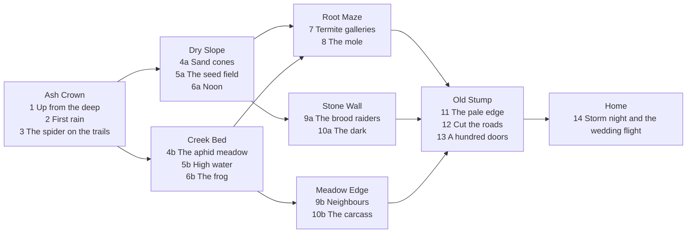
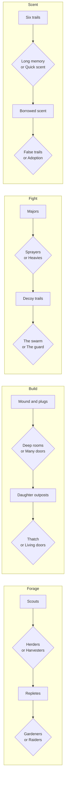

# Cinderhill: the full game

Written 2026-11-27 after the owner played the first slice of the rebuild and said the spec was too basic. The owner's ask, in his words: "an Empires of the Undergrowth alike game. Missions, worthwhile base building, strategy, variety, progression and tech tree, meaningful decision branch." Graphics do not have to match the reference. The model is freeciv beside Civilization: the same depth of genre, our own expression.

This file sets the size and shape of the whole game. [02-spec.md](02-spec.md) stays the authority for the numbers of the first three missions (pace budget, starting values, the first five minutes). Where the two differ, this file wins.

## 0. What this file replaces

| 02 said | Now |
| --- | --- |
| Done is six Spring chapters on one hill | Done is a campaign of 19 missions on a branching map, a home nest worth building, a tech tree with exclusive picks, nine castes, twelve kinds of enemy and three rival colonies. A first-time player finishes mission 3 without help and starts mission 4. Two playthroughs can differ in the order of six missions, in which two of four they play at the second fork, and in all eight tree picks |
| "Progress is the colony itself and the bloom". No currency between chapters | The colony still carries. Added: **amber** (earned per mission) and **bloom** (regions regrown) pay for and gate a tech tree, the **Lineage** |
| A room's worth comes from depth, size and dryness only | Rooms have a function, a capacity and a **supply time** (walking time to what the room needs, read from the flow fields). Layout decides output |
| Wordless play | No narrator and no story text. Mission goals, room names and Lineage picks have short labels, because a strategy choice the player cannot read is not a choice |
| Six chapters with one new verb each | Missions of six types on seven regions, each with a main goal, two side goals and one dilemma |

Everything else in 02's "Not taken" table still holds: no narrator, no lab or scientists, no hex tiles or neighbour upgrades, no numbered scent groups, no shared class name for big animals, none of the excluded biology in [07](07-biology-ideas.md), nothing of the reference game's names, levels, look, UI or music. The owner's earlier taste calls (11 and 12) hold where this file does not change them.

## 1. The six things, one row each

| Asked for | The decision the player makes | What the sim must hold | In sim 11 today |
| --- | --- | --- | --- |
| Missions | Which goal to chase first; whether a side goal is worth the risk; when to stop growing and commit | A mission record (map, start, goals, timed and triggered events, rewards) read as config; goal state and win or loss as sim state and events | Days with a food quota and a dusk event. No goals, no scripts |
| Worthwhile base building | Where each room goes, how deep, how wide the tunnels and how many doors: short supply lines against flood, raid and jam risk | Room kinds painted on dug cells; capacity per cell; supply time per room from flow fields; stores that live in rooms; a population cap from rest halls | Free digging, a nursery rectangle, doors with throughput and jams. One global store |
| Strategy | Where to spend ants: forage, dig, guard, scout, raid. Which food site to hold. Which trail to hide or use as bait | Rival colonies that play by the player's own orders; shared scent; sight (unscouted ground is hidden); contested sites; castes with counters | Trails, crews, alarm, recall, one spider, majors. One team of ants |
| Variety | Which castes to raise and what to feed them; how to answer each enemy | Nine castes with different speed, load, strength and job; twelve enemy kinds, each with one readable rule and one counter; four food chains; weather and time of day | Worker and major. Sugar and protein piles |
| Progression and tech tree | Which Lineage bough to grow first; which of two exclusive picks at each fork | Tech as a bit set in the mission config that changes rules deterministically; unlock checks inside the sim so a replay is exact | None |
| Meaningful decision branch | Which region to settle first (the other changes while you are away); a dilemma in each mission whose result comes back later | Campaign state outside the sim (a new storage key); mission config built from it (flags such as "neighbours spared") | None |

## 2. Shape of the campaign

The colony survived the fire under the crown of the hill. Each mission sends a young queen and an escort to found a **daughter nest** in a new place. Win, and that nest joins the colony: it sends a steady trickle of its region's food home and opens the regions beyond it. Lose, and the escort is lost; the colony carries on smaller (owner choice 12-E) and may try again. The campaign map is therefore a picture of the colony's own network spreading over the hill, and the hill turning green behind it.

On the far side of the hill a second network is spreading the same way: the **pale colony**, many nests under one scent. The last region is where the two meet.

**Forks.** After mission 3 the player settles Dry Slope or Creek Bed first. The other stays open, but it changes while the colony is away: the pale colony's scouts reach it, so its missions start with a rival already holding the best site. After the Root Maze the player goes to Stone Wall or Meadow Edge; the one not chosen falls to the pale colony and becomes one of its nests in the last region. A playthrough is 17 missions out of 19.

**Mission types.** Every mission has one main goal, two side goals (each pays one amber) and one dilemma.

| Type | Main goal | Missions |
| --- | --- | --- |
| Found and grow | Reach a colony size or a store by dusk | 1, 4b, 5a |
| Hold | Keep the queen alive through an event | 2, 6a, 9a, 11 |
| Hunt or drive off | Beat or outlast one large animal | 3, 6b, 8 |
| Route | Open and run a supply line through hazards | 4a, 12 |
| Move | Carry the queen and brood to a new nest before the old one is lost | 5b, 10a |
| Contest | Take or hold a site against another colony | 7, 9b, 10b, 13, 14 |

**Dilemmas** are choices inside a mission that the campaign remembers. Each is made by play, not by a dialog. Examples: in *Termite galleries* the player can break into the termite nest for protein (fast food now, termite soldiers in every later underground mission) or wall it off and share the wood (slower, and a quiet flank later). In *Neighbours* a beaten rival can be finished, left alone, or fed; a fed neighbour holds one road in mission 11. In *The carcass* three colonies want one dead vole; holding all of it starves the smallest, who then joins the pale colony.

## 3. The home nest

Between missions the player is at the **home nest**, the same sim as a mission with no clock. It persists. What it is for:

- **The expedition.** Each mission's escort is drawn from home: a number of slots set by the home rest halls, filled by caste from what the home nurseries have raised. A better home sends a stronger start.
- **The trickle.** Daughter nests send food home. Home granaries and larders cap what can be kept.
- **It is attacked.** Missions 9a and 14 are fought in the home nest as the player built it, with its real doors, tunnels and stores. Nothing else makes layout matter as much.
- **Repair.** Any room can be repainted and any tunnel refilled, at a cost in loads. No early mistake is permanent.

## 4. Base building

Free digging stays. A **room** is a dug space painted with a kind. Its output is capacity times a rate, and the rate falls as its supply time rises.

| Room | Does | Wants | Opened by |
| --- | --- | --- | --- |
| Queen's chamber | Lays eggs. Enlarging it raises the colony's **tier** (1 to 4), which opens room kinds and castes inside a mission | Deep and dry; short path to a nursery | Start |
| Nursery | Raises brood. A **diet** set on the room (lean, rich, or a special food) decides the caste | Short path to the larder; warmth near the surface by day, depth by night | Start |
| Granary | Keeps seeds and sugar | Dry; near a door | Start |
| Larder | Keeps protein; it spoils slowly if warm | Deep and cool | Mission 2 |
| Rest hall | Raises the population cap; resting ants heal | Anywhere; near doors it doubles as a muster point | Mission 3 |
| Midden | Takes husks and the dead. Near brood it causes sickness; near the surface it sprouts (bloom) | Far from nurseries | Mission 1 |
| Guard post | Holds a set number of fighters at a door or junction | A tunnel one or two cells wide | Lineage |
| Root stable | Root aphids give sugar underground with no trail to defend | Tree roots in the soil | Lineage (Herders) |
| Fungus garden | Turns leaves into food on a delay; its waste must reach the midden | Deep, damp, never flooded | Lineage (Gardeners) |
| Honey hall | Repletes hang here as living stores that can walk to a new nest | Deep | Lineage |
| Thatch dome | Warms the top nursery so brood grows faster; burns in a dry storm | The surface mound | Lineage (Thatch) |

Tunnels have a width the player chooses. Narrow tunnels are cheap and easy to hold; wide ones carry traffic. Doors have throughput (already in the sim), so a second door is a real trade between speed and exposure. Water, cave-ins and the structures of 02 section 6.5 stay.

## 5. The Lineage (tech tree)

Four boughs of four levels. A level opens when enough regions have bloomed. Each node costs amber. At levels 2 and 4 each bough **forks**: the player takes one side and the other is closed for this campaign. That is eight exclusive picks. The wedding flight at the end carries one chosen fork pick into a new campaign on a harder hill.

| Fork | One side | Other side |
| --- | --- | --- |
| Forage 2 | **Herders**: aphid herds on plants and roots give steady sugar and must be moved and guarded | **Harvesters**: seeds keep through any dry spell; majors crack them; granaries hold twice as much |
| Forage 4 | **Gardeners**: the leaf to fungus chain feeds a huge colony from a safe room, slowly | **Raiders**: rival and termite brood carried home becomes protein or, with Adoption, workers |
| Build 2 | **Deep rooms**: rooms far down are worth more and never flood; every trip is longer | **Many doors**: extra doors are cheap and jams end; every door must be held |
| Build 4 | **Thatch**: brood grows a third faster under a warm dome that can burn | **Living doors**: a door caste whose heads close a tunnel; a held door loses no ants |
| Fight 2 | **Sprayers**: acid from a distance, strong in the open, useless in a tunnel one cell wide | **Heavies**: slow giants that pin large animals and hold a tunnel alone |
| Fight 4 | **The swarm**: workers cost half the protein and fight in the open by weight of numbers | **The guard**: fighters that have survived a fight grow stronger and are kept between missions |
| Scent 2 | **Long memory**: trails last all day and strengthen with use; rivals read them easily | **Quick scent**: trails answer at once and fade in a minute; little for a rival to read |
| Scent 4 | **False trails**: a trail that rivals follow and your own ants ignore | **Adoption**: workers of a beaten colony join yours |

Nodes that do not fork: Scouts (fast, see far, mark food and danger on the map), Repletes, Mound and plugs, Daughter outposts (a second small nest inside a mission), Majors, Decoy trails, Six trails (up from four, with crew presets), Borrowed scent (walk a rival's trail unnoticed for a while).

Inside a mission none of this is free: a pick opens a room or a caste, and the colony must still reach the tier, dig the room and feed the brood.

## 6. Castes and enemies

**Castes.** Worker, nurse (the youngest workers, by age), scout, major, sprayer or heavy, replete, door caste, gardener (tiny, cannot fight), and the winged ones of the last mission. A beaten colony's adopted workers are a tenth kind.

**Enemies**, each with one rule the player can see and one clean answer:

| Enemy | Rule | Answer |
| --- | --- | --- |
| Bird | Strikes the densest group in the open after a shadow | Cover, thin trails, recall |
| Spider in ant scent | Walks the busiest trail | Cut the trail, majors, a decoy |
| Antlion | A pit that takes whatever walks the slope | Route around, fill it, a span |
| Wasp | Lifts single foragers from the edges of a trail | Roofs, short trails, sprayers |
| Frog | Eats in a cone in front of it, sleeps at noon | Come from behind, pass at noon, lure it with a carcass onto a rival |
| Mole | Tunnels through the nest and collapses loose rooms | Roots and clay, plugs, heavies at the breach |
| Termites | Soldiers that hold any tunnel one cell wide | Break in from two sides, or wall them off |
| Guest beetle | Lives in the nest unseen and eats brood | Guard posts at the nursery, a clean midden |
| Brood raiders | A rival that takes pupae, not food | Plugs, living doors, moving brood deep |
| Slug | Lays slime that wipes scent | Redraw, or use it to erase a trail a rival is reading |
| Neighbour colonies (three temperaments: harvesters that turtle, a small fast colony that raids, a large slow one that claims food sites) | The player's own orders and rules | Everything above |
| The pale colony | Many nests, one scent, no borders between them | Cut its roads; take nests one at a time |

Combat keeps the contact rule of 02 section 6.4: numbers win in the open, quality and doors win in a tunnel.

## 7. Build order

No dates. Each step is played by the owner before the next is called done.

1. **One full loop, thin.** Missions 1 to 3 with goals, side goals and a result card; amber; the campaign map with the first fork; one Lineage fork (Forage 2); missions 4a and 4b, which play differently under each pick. This proves missions, progression and a branch together.
2. **Rooms.** Painted room kinds with capacity and supply time; stores that live in rooms; the population cap; colony tiers.
3. **The home nest** and the expedition.
4. **A rival colony** that plays by the same orders, with sight and scouting. Then missions 9b and 10b.
5. **The roster**: the remaining castes and enemies, one mission at a time, each with its mission.
6. **The remaining regions**, the pale colony and the last mission.
7. Free hill (the old painter page folds into the new client as this mode), the daily founding run, friends by link (02 section 9).

Missions are data: a mission is one file of map, start, goals, events and rewards, so adding one does not change the sim. Lineage picks and mission goals are sim rules: they enter as config and replay exactly. Campaign state uses a new storage key; no existing key or format changes.

## 8. For the owner to pick

Building goes ahead on the first option of each. Each can be changed later at the cost noted.

| Question | Options |
| --- | --- |
| Between missions | **A. A home nest you build and defend** (section 3). B. A map and the Lineage only; all building happens inside missions. A makes building matter more and costs one more system |
| How hard forks lock | **A. Closed for the campaign; the wedding flight carries one pick into the next.** B. Closed until you pay amber to switch. C. Everything can be had in the end and only the order differs (the freeciv way). A makes each pick matter most |
| The region not taken | **A. Stays open but a rival settles it first** (first fork); **falls to the pale colony** (second fork). B. Always stays open unchanged |
| Labels | **A. Short labels on goals, rooms and picks; no story text.** B. Fully wordless with icons only |
